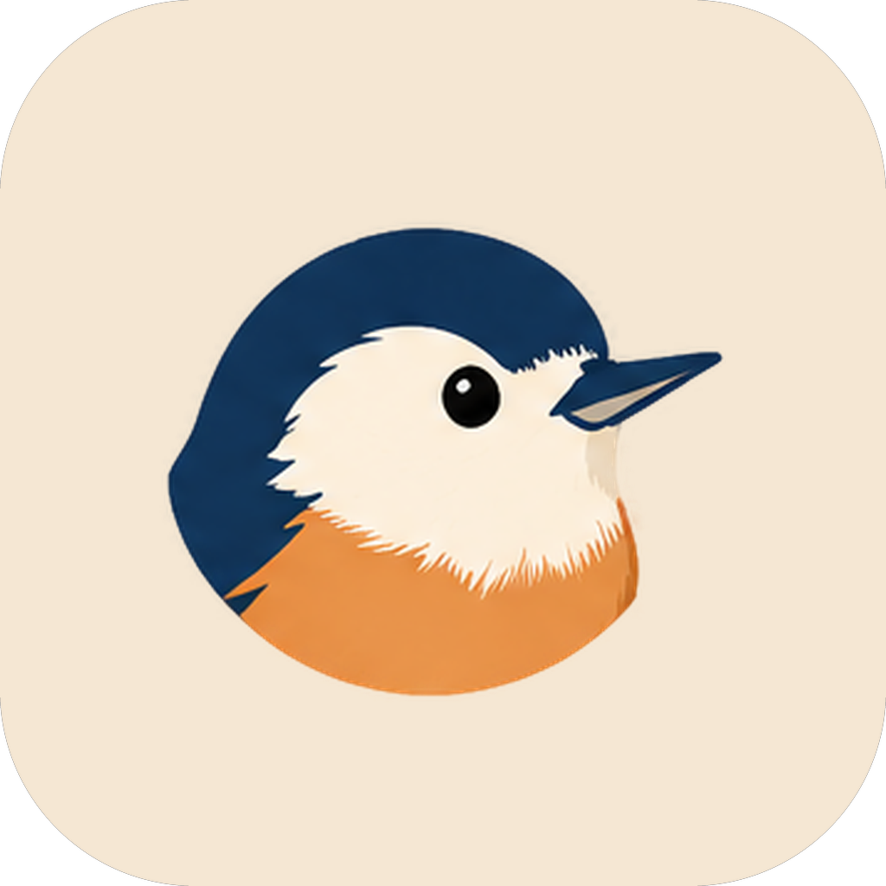

# NIBI

<div align="center">
  

  <p><strong>把长时间、高密度的开发工作，收进一个窗口。</strong></p>

  <p>
    <a href="README.en.md">English</a> ·
    <a href="docs/README.md">文档</a> ·
    <a href="docs/release-process.md">发布说明</a>
  </p>
</div>

NIBI 是一个面向真实开发工作的 AI 工作台。对话、终端、文件、工具、插件、远程工作区和手机远控共享同一个上下文，不需要在多个窗口之间反复搬运状态。

它适合长时间运行的编码任务，也适合需要同时处理多个项目、多个会话和多台机器的开发者。

## 为什么是 NIBI

- **从对话直接进入工作**：读取文件、运行命令、查看 diff、预览产物，不必把结果复制到另一个工具里继续。
- **长时间会话不散**：任务、队列、子代理、后台执行和恢复都在同一个工作区里管理。
- **本地与远程同一套体验**：本地项目、SSH、WSL、Docker 和远端工作区使用同一套会话与权限语义。
- **离开电脑也能继续**：手机扫码连接桌面会话，查看进度、回复问题和处理等待中的任务。
- **按你的方式扩展**：插件、MCP、技能、Hook 和工作流都可以接入现有工作流。
- **Rust 原生内核**：桌面 Agent 由 Rust 内核驱动，长时间运行时响应和资源占用更可控。

## 你可以用它做什么

| 场景           | NIBI 能做什么                                      |
| -------------- | -------------------------------------------------- |
| 写代码与改 bug | 在对话里定位、修改、运行和验证，不用频繁切换上下文 |
| 维护大型代码库 | 多工作区、任务与会话并行，保留每一步的线索         |
| 处理长任务     | 队列、子代理、后台执行、恢复与通知                 |
| 远程开发       | SSH、WSL、Docker 和远端工作区统一接入              |
| 随时接续       | 手机远控查看任务、回复问题和处理等待中的操作       |
| 扩展工作流     | 插件、MCP、技能、Hook 和自动化任务                 |

## 产品原则

- **本地优先**：项目、会话和配置默认留在你的设备上；远程连接是明确动作。
- **结果要能被检查**：工具调用、文件变更和执行结果都可回看，不把“模型说完成了”当成完成。
- **能力有边界**：不可用的能力会明确说明，不伪造成功，也不偷偷换一条路径继续。
- **可恢复**：长任务、会话和子代理有恢复路径，不要求你从头再来。

## 平台

- Windows 与 Linux 提供桌面构建。
- macOS 支持源码构建，安装包发布暂缓。
- 公开源码构建未签名；正式分发以官方发布渠道为准。

## 从源码开始

环境要求：Node.js 24.22.1、pnpm 10.33.2、Rust 1.95.0、Git。

```bash
pnpm bootstrap
pnpm dev:desktop
```

需要独立数据目录时：

```bash
NIBI_DATA_BASE_DIR="$HOME/.nibi-dev" pnpm dev:desktop
```

其他入口：

| 命令            | 用途              |
| --------------- | ----------------- |
| `pnpm install`  | 只安装依赖        |
| `pnpm build`    | 构建 workspace    |
| `pnpm dev:web`  | 启动 Web 开发环境 |
| `pnpm dev:docs` | 启动开发文档站    |

## 文档

- [开发文档](docs/README.md)
- [架构总览](docs/architecture/nibi-code-architecture-overview.md)
- [Rust 内核对照](docs/rust-kernel-function-parity.md)
- [发版流程](docs/release-process.md)

## 参与贡献

- 提交前阅读 [CONTRIBUTING.md](CONTRIBUTING.md)。
- 安全问题请按 [SECURITY.md](SECURITY.md) 私下报告，不要开公开 issue。
- 行为准则见 [CODE_OF_CONDUCT.md](CODE_OF_CONDUCT.md)。

## 许可证

第一方代码以 [Apache License 2.0](LICENSE) 发布。上游来源、第三方组件与再分发边界见 [LICENSING.md](LICENSING.md)、[NOTICE.md](NOTICE.md) 和 [THIRD-PARTY-NOTICES.md](THIRD-PARTY-NOTICES.md)；NIBI 名称与标识的使用规则见 [TRADEMARKS.md](TRADEMARKS.md)。
